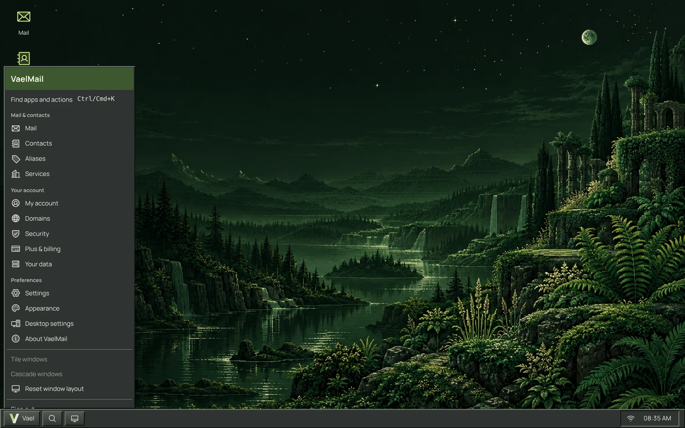
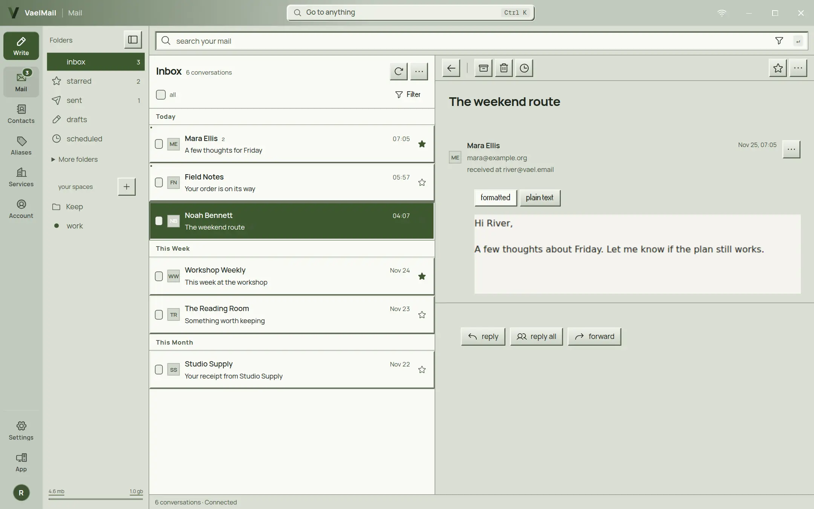
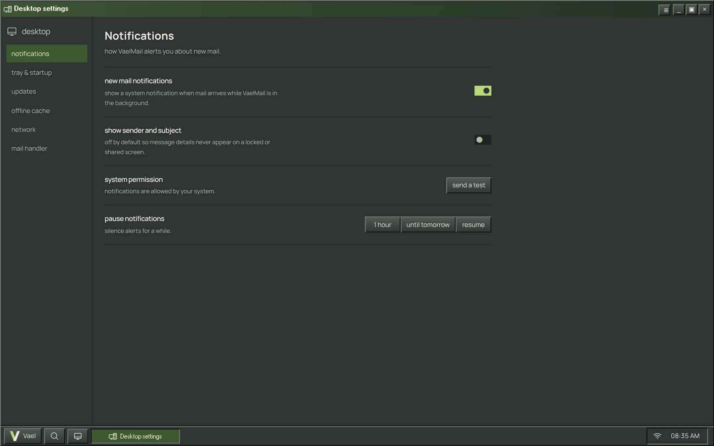
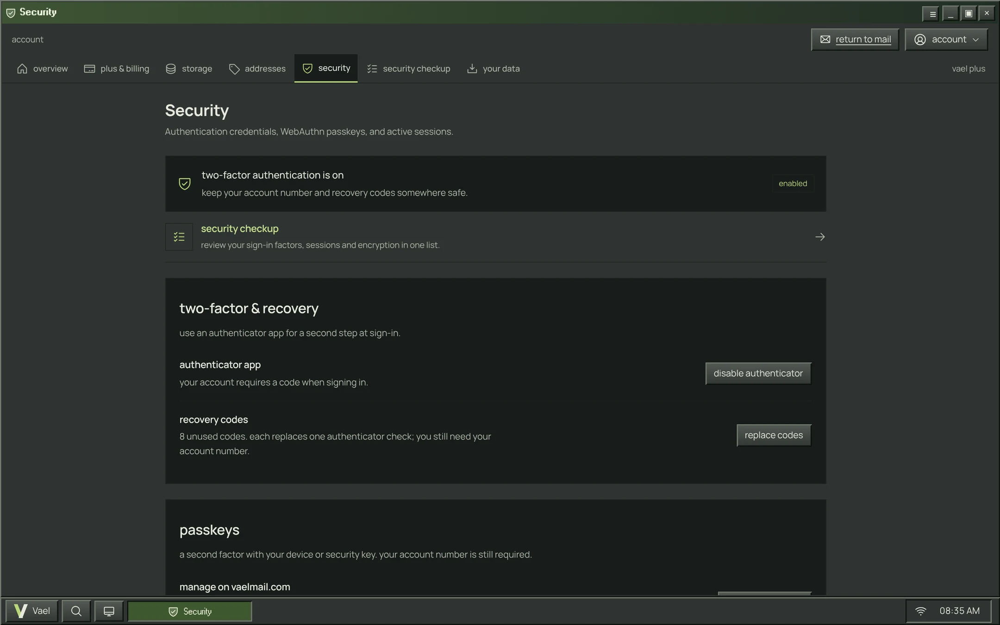
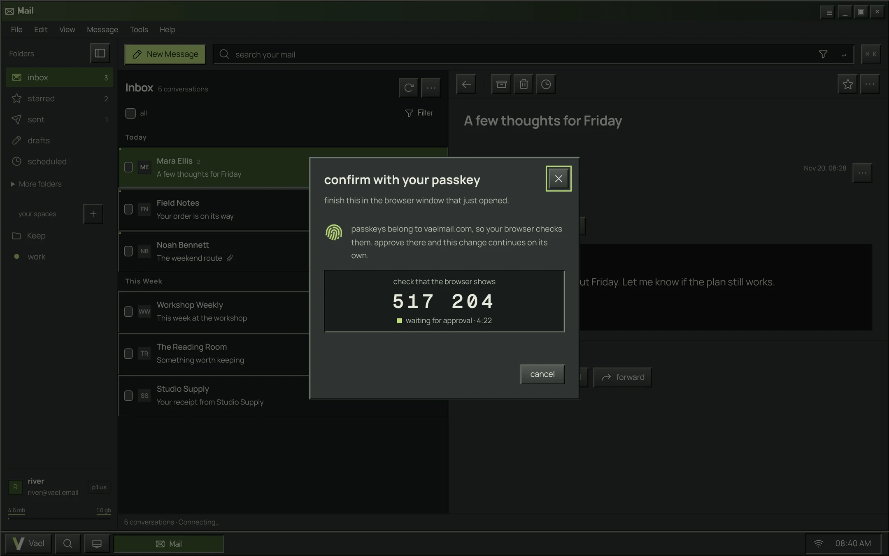

# VaelMail Desktop

The desktop app for [VaelMail](https://vaelmail.com). It runs on Windows, macOS and Linux and
brings the Vael98 desktop from the web app into a window of its own, with native notifications,
a tray icon, an encrypted offline cache and `mailto:` links that open straight into a new message.


## Install

The quickest way is one line in a terminal. It picks the right build for your system, installs it
and keeps your settings when you run it again to update or repair.

**Linux and macOS**

```bash
curl -fsSL https://raw.githubusercontent.com/vaelmail/vaelmail-desktop/main/install.sh | bash
```

**Windows** (PowerShell)

```powershell
irm https://raw.githubusercontent.com/vaelmail/vaelmail-desktop/main/install.ps1 | iex
```

On Linux the installer asks whether you want the AppImage in your home folder (no sudo, updates
itself) or a `.deb` or `.rpm` through apt, dnf or zypper. On distributions without those it uses
the AppImage. It adds VaelMail to your app menu and can start it when you sign in and make it your
mail app. On macOS it installs `VaelMail.app` into Applications, and on Windows it downloads the
installer for your PC and opens it.

Running it again on a system that already has VaelMail offers to update, reinstall or remove it.
Options go after `bash -s --` on Linux and macOS:

| Option        | What it does                                                        |
| ------------- | ------------------------------------------------------------------- |
| `--yes`       | Install with the defaults, without asking                           |
| `--appimage`  | Linux: use the AppImage                                             |
| `--package`   | Linux: use the `.deb` or `.rpm`                                     |
| `--uninstall` | Remove VaelMail                                                     |
| `--purge`     | With `--uninstall`, also remove settings, offline cache and sign-in |
| `--no-launch` | Don't open VaelMail when it's done                                  |

```bash
curl -fsSL https://raw.githubusercontent.com/vaelmail/vaelmail-desktop/main/install.sh | bash -s -- --uninstall
```

On Windows, use `-Quiet` to install without the setup window or `-Uninstall` to remove it:

```powershell
& ([scriptblock]::Create((irm https://raw.githubusercontent.com/vaelmail/vaelmail-desktop/main/install.ps1))) -Quiet
```

## Download

Prefer to do it by hand? Grab the latest build from the
[releases page](https://github.com/vaelmail/vaelmail-desktop/releases/latest).

| Platform                         | Installer                                                                                                                                                                                                                                                                                                                         | Portable                                                                                                                           |
| -------------------------------- | --------------------------------------------------------------------------------------------------------------------------------------------------------------------------------------------------------------------------------------------------------------------------------------------------------------------------------- | ---------------------------------------------------------------------------------------------------------------------------------- |
| Windows 10 and 11, x64           | [Installer (.exe)](https://github.com/vaelmail/vaelmail-desktop/releases/latest/download/VaelMail-windows-x64-setup.exe)                                                                                                                                                                                                          | [Portable (.zip)](https://github.com/vaelmail/vaelmail-desktop/releases/latest/download/VaelMail-windows-x64-portable.zip)         |
| Windows 11, arm64                | [Installer (.exe)](https://github.com/vaelmail/vaelmail-desktop/releases/latest/download/VaelMail-windows-arm64-setup.exe)                                                                                                                                                                                                        | [Portable (.zip)](https://github.com/vaelmail/vaelmail-desktop/releases/latest/download/VaelMail-windows-arm64-portable.zip)       |
| macOS 11 or later, Apple silicon | [Disk image (.dmg)](https://github.com/vaelmail/vaelmail-desktop/releases/latest/download/VaelMail-macos-apple-silicon.dmg)                                                                                                                                                                                                       | [Portable (.zip)](https://github.com/vaelmail/vaelmail-desktop/releases/latest/download/VaelMail-macos-apple-silicon-portable.zip) |
| macOS 11 or later, Intel         | [Disk image (.dmg)](https://github.com/vaelmail/vaelmail-desktop/releases/latest/download/VaelMail-macos-intel.dmg)                                                                                                                                                                                                               | [Portable (.zip)](https://github.com/vaelmail/vaelmail-desktop/releases/latest/download/VaelMail-macos-intel-portable.zip)         |
| Linux, x64                       | [AppImage](https://github.com/vaelmail/vaelmail-desktop/releases/latest/download/VaelMail-linux-x64.AppImage) · [.deb](https://github.com/vaelmail/vaelmail-desktop/releases/latest/download/VaelMail-linux-x64.deb) · [.rpm](https://github.com/vaelmail/vaelmail-desktop/releases/latest/download/VaelMail-linux-x64.rpm)       | [Portable (.tar.gz)](https://github.com/vaelmail/vaelmail-desktop/releases/latest/download/VaelMail-linux-x64-portable.tar.gz)     |
| Linux, arm64                     | [AppImage](https://github.com/vaelmail/vaelmail-desktop/releases/latest/download/VaelMail-linux-arm64.AppImage) · [.deb](https://github.com/vaelmail/vaelmail-desktop/releases/latest/download/VaelMail-linux-arm64.deb) · [.rpm](https://github.com/vaelmail/vaelmail-desktop/releases/latest/download/VaelMail-linux-arm64.rpm) | [Portable (.tar.gz)](https://github.com/vaelmail/vaelmail-desktop/releases/latest/download/VaelMail-linux-arm64-portable.tar.gz)   |

The Windows and macOS installers and the AppImage update themselves. With `.deb` and `.rpm`,
updates come from the new package. Portable copies don't update themselves: replace the app and
keep the `VaelMail Data` folder next to it.

## What's in it

Everything you can do on vaelmail.com once you're signed in is here: mail, contacts, aliases,
services, domains, settings, security, billing and data export. Every app opens maximized, and you
can still restore, snap and tile windows like on the web desktop.

|                                                             |                                                                                    |
| ----------------------------------------------------------- | ---------------------------------------------------------------------------------- |
|              |                                 |
| The start menu and `Ctrl/Cmd+K` reach every app and action. | Compose with identities, attachments, scheduling and OpenPGP.                      |
|             |                         |
| Dark and light themes, the same as the web app.             | Settings for notifications, startup, updates, cache, network and the mail handler. |

On top of the web app, the desktop version adds:

- **Notifications** for new mail. Clicking one opens that conversation. Sender and subject stay
  hidden unless you turn them on.
- **Tray and badge.** Close the window and VaelMail keeps running in the tray, with the unread
  count on the icon. It can also start when you log in.
- **Default mail app.** `mailto:` links on your system open a new message in VaelMail.
- **Drag and drop.** Drop files into a message to attach them, or drag an attachment out onto your
  desktop.
- **Offline.** Recent mail is kept in an encrypted cache, so the app starts instantly and you can
  read without a connection. Messages you send while offline go out when you're back online.
- **Windows jump list** with New message and Inbox.
- **Proxy support**, including SOCKS5 for Tor.

## Signing in

You sign in with your account number and an authenticator code or a recovery code, exactly as on
the web. Accounts are created on [vaelmail.com](https://vaelmail.com/register).

Passkeys belong to vaelmail.com, so the app can't use them directly. Choose "continue in browser"
and the app opens a one-time link and shows a six-digit code. Check that the browser shows the same
code, approve with your passkey, and the app signs itself in. The same flow works when a security
change asks you to confirm it's you.

|                                                      |                                                             |
| ---------------------------------------------------- | ----------------------------------------------------------- |
|  |  |
| Two-factor, recovery codes, sessions and encryption. | Confirming a change with a passkey in the browser.          |

## Installer and portable mode

The Windows installer doesn't need administrator rights. It asks whether you want Start menu and
desktop shortcuts, whether VaelMail should start when you sign in, and whether it should handle
email links. The uninstaller asks whether to also remove your settings, offline cache and saved
sign-in.

The portable builds run from any folder, including a USB stick. A `VaelMail.portable` file next to
the app keeps all its data in a `VaelMail Data` folder beside it instead of in your user profile.
Nothing goes into the registry, the keychain or your login items. Delete that file and the same
copy behaves like an installed one.

## Privacy

- The interface never talks to the network itself. Every request goes through the app's Rust
  core, which only talks to vaelmail.com.
- No analytics, no crash reporting, no third-party requests. The only other contact is the update
  check against GitHub releases, which you can turn off.
- The session token lives in the system keychain (Keychain, Credential Manager, Secret Service).
- The offline cache is an SQLCipher database whose key is also in the keychain. Encrypted
  mailboxes are left out of it unless you opt in, and it's wiped when you sign out.

## Building from source

You need Node 22, pnpm, a recent stable Rust and the
[Tauri prerequisites](https://v2.tauri.app/start/prerequisites/) for your platform.

```bash
pnpm install
pnpm tauri dev      # run the app
pnpm tauri build    # build installers for this platform
pnpm dev            # interface only, in a browser, with sample data
```

Before sending a change:

```bash
pnpm lint && pnpm typecheck && pnpm test && pnpm check:comments
cargo clippy --workspace --all-targets -- -D warnings
cargo test --workspace
```

The Vael98 styles in `src/styles/vael98` are generated from the web app with `pnpm sync:styles`,
so change them there, not here.

## How it's put together

The window is a [Tauri 2](https://v2.tauri.app) app. The interface is React and TypeScript.
Networking, storage and everything native are in Rust.

| Path                 | What's there                                                      |
| -------------------- | ----------------------------------------------------------------- |
| `src`                | The interface: desktop shell, apps, mail, account pages           |
| `src/lib/bridge`     | Typed calls from the interface into Rust                          |
| `crates/vael-client` | HTTP and WebSocket client, session, edge challenge solver         |
| `crates/vael-store`  | Keychain, encrypted cache, settings                               |
| `src-tauri`          | The app itself: commands, tray, notifications, updater, protocols |
| `src-tauri/windows`  | The Windows installer script and artwork                          |
| `install.sh`         | The one-line installer for Linux and macOS                        |
| `install.ps1`        | The one-line installer for Windows                                |
| `docs`               | [Architecture notes](docs/architecture.md)                        |

Releases are built by GitHub Actions when a `vX.Y.Z` tag is pushed. The workflow builds the
installers and portable archives for every platform, signs the update files with the project's
updater key and publishes the release.

## License

VaelMail Desktop is source-available under the
[PolyForm Strict License 1.0.0](LICENSE). You can read the code and use it for personal and
noncommercial purposes. You can't copy it, redistribute it, change it or use it commercially
without written permission. Third-party components keep their own licenses, listed in
[THIRD_PARTY_NOTICES.md](THIRD_PARTY_NOTICES.md).

## Credits

The Vael98 look builds on [98.css](https://github.com/jdan/98.css),
[Phosphor icons](https://phosphoricons.com) and the fonts listed in
[THIRD_PARTY_NOTICES.md](THIRD_PARTY_NOTICES.md).
