<div align="center">


# VaelMail Desktop

The [VaelMail](https://vaelmail.com) desktop app for Windows, macOS and Linux.

[Download](https://github.com/vaelmail/vaelmail-desktop/releases/latest) · [Website](https://vaelmail.com) · [Screenshots](#gallery) · [Architecture](docs/architecture.md)

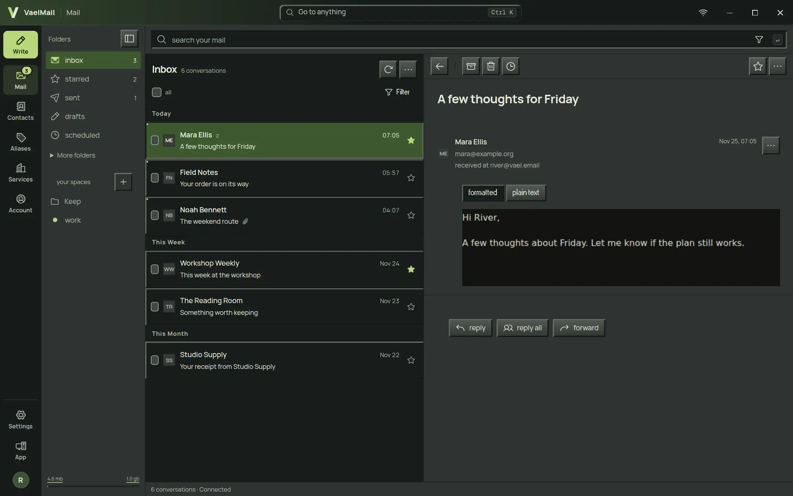

</div>

## Install

**Linux and macOS**

```bash
curl -fsSL https://vaelmail.com/desktop/install.sh | bash
```

**Windows** (PowerShell)

```powershell
irm https://vaelmail.com/desktop/install.ps1 | iex
```

The script picks the right build for your system. Run it again to update, reinstall or remove VaelMail.

<details>
<summary>Installer options</summary>

<br>

Pass options after `bash -s --`, for example `curl -fsSL https://vaelmail.com/desktop/install.sh | bash -s -- --uninstall`.

| Option        | Effect                                                      |
| ------------- | ----------------------------------------------------------- |
| `--yes`       | Use the defaults without asking                             |
| `--appimage`  | Linux only. Install the AppImage, no sudo needed            |
| `--package`   | Linux only. Install the `.deb` or `.rpm`                    |
| `--uninstall` | Remove VaelMail                                             |
| `--purge`     | With `--uninstall`, also delete settings, cache and sign-in |
| `--no-launch` | Don't open VaelMail after installing                        |

On Windows, `-Quiet` installs without the setup window and `-Uninstall` removes the app:

```powershell
& ([scriptblock]::Create((irm https://vaelmail.com/desktop/install.ps1))) -Quiet
```

</details>

## Download

| Platform                 | Installer                                                                                                                                                                                                                                                                                                                         | Portable                                                                                                                |
| ------------------------ | --------------------------------------------------------------------------------------------------------------------------------------------------------------------------------------------------------------------------------------------------------------------------------------------------------------------------------- | ----------------------------------------------------------------------------------------------------------------------- |
| Windows 10/11, x64       | [.exe](https://github.com/vaelmail/vaelmail-desktop/releases/latest/download/VaelMail-windows-x64-setup.exe)                                                                                                                                                                                                                      | [.zip](https://github.com/vaelmail/vaelmail-desktop/releases/latest/download/VaelMail-windows-x64-portable.zip)         |
| Windows 11, arm64        | [.exe](https://github.com/vaelmail/vaelmail-desktop/releases/latest/download/VaelMail-windows-arm64-setup.exe)                                                                                                                                                                                                                    | [.zip](https://github.com/vaelmail/vaelmail-desktop/releases/latest/download/VaelMail-windows-arm64-portable.zip)       |
| macOS 11+, Apple silicon | [.dmg](https://github.com/vaelmail/vaelmail-desktop/releases/latest/download/VaelMail-macos-apple-silicon.dmg)                                                                                                                                                                                                                    | [.zip](https://github.com/vaelmail/vaelmail-desktop/releases/latest/download/VaelMail-macos-apple-silicon-portable.zip) |
| macOS 11+, Intel         | [.dmg](https://github.com/vaelmail/vaelmail-desktop/releases/latest/download/VaelMail-macos-intel.dmg)                                                                                                                                                                                                                            | [.zip](https://github.com/vaelmail/vaelmail-desktop/releases/latest/download/VaelMail-macos-intel-portable.zip)         |
| Linux, x64               | [AppImage](https://github.com/vaelmail/vaelmail-desktop/releases/latest/download/VaelMail-linux-x64.AppImage) · [.deb](https://github.com/vaelmail/vaelmail-desktop/releases/latest/download/VaelMail-linux-x64.deb) · [.rpm](https://github.com/vaelmail/vaelmail-desktop/releases/latest/download/VaelMail-linux-x64.rpm)       | [.tar.gz](https://github.com/vaelmail/vaelmail-desktop/releases/latest/download/VaelMail-linux-x64-portable.tar.gz)     |
| Linux, arm64             | [AppImage](https://github.com/vaelmail/vaelmail-desktop/releases/latest/download/VaelMail-linux-arm64.AppImage) · [.deb](https://github.com/vaelmail/vaelmail-desktop/releases/latest/download/VaelMail-linux-arm64.deb) · [.rpm](https://github.com/vaelmail/vaelmail-desktop/releases/latest/download/VaelMail-linux-arm64.rpm) | [.tar.gz](https://github.com/vaelmail/vaelmail-desktop/releases/latest/download/VaelMail-linux-arm64-portable.tar.gz)   |

The installers and the AppImage update themselves. `.deb` and `.rpm` update with a new package. Portable builds don't update. To upgrade one, replace the app and keep the `VaelMail Data` folder.

## Features

Everything from vaelmail.com is here: mail, contacts, aliases, domains, security, billing and export. The desktop app adds:

- **Notifications** for new mail. Sender and subject stay hidden unless you turn them on.
- **Tray icon** with an unread badge. Closing the window keeps the app running.
- **Default mail app.** `mailto:` links open a new message.
- **Offline mode.** Recent mail sits in an encrypted cache. Mail sent offline goes out when you reconnect.
- **Drag and drop** attachments in and out of messages.
- **Proxy support**, including SOCKS5 for Tor.
- **Portable mode** that runs from a USB stick and writes nothing to the registry or keychain.
- **Go to anything.** <kbd>Ctrl</kbd> <kbd>K</kbd> (<kbd>Cmd</kbd> <kbd>K</kbd> on a Mac) opens any folder, page or action. <kbd>Ctrl</kbd> <kbd>1</kbd> to <kbd>6</kbd> switch between Mail, Contacts, Aliases, Services, Account and Settings.
- **Keeps working under heavy traffic.** When vaelmail.com asks for a security check, the app solves it in the background. During an attack it asks for a short code, or continues by itself after 30 seconds.

## Signing in

Sign in with your account number and an authenticator or recovery code. Create an account at [vaelmail.com](https://vaelmail.com/register).

For passkeys, choose **Continue in browser**. The app shows a six-digit code. Check that the browser shows the same code, approve with your passkey, and the app signs in.

## Privacy

- The interface makes no network requests. All traffic goes through the Rust core, which only talks to vaelmail.com.
- No analytics, no crash reports and no third-party requests. The update check against GitHub releases can be turned off.
- The session token is stored in the system keychain.
- The offline cache is an SQLCipher database with its key in the keychain. Signing out wipes it.

## Build from source

Requires Node 22, pnpm, stable Rust and the [Tauri prerequisites](https://v2.tauri.app/start/prerequisites/).

```bash
pnpm install
pnpm tauri dev      # run the app
pnpm tauri build    # build installers for this platform
pnpm dev            # interface only, in a browser, with sample data
```

Checks to run before a change:

```bash
pnpm lint && pnpm typecheck && pnpm test && pnpm check:comments
cargo clippy --workspace --all-targets -- -D warnings
cargo test --workspace
```

<details>
<summary>Project layout</summary>

<br>

| Path                 | Contents                                             |
| -------------------- | ---------------------------------------------------- |
| `src`                | React interface: app shell, views, mail, account     |
| `src/lib/bridge`     | Typed calls from the interface into Rust             |
| `crates/vael-client` | HTTP and WebSocket client, session, edge challenge   |
| `crates/vael-store`  | Keychain, encrypted cache, settings                  |
| `src-tauri`          | Tauri 2 app: commands, tray, notifications, updater  |
| `installer`          | VaelMail Setup, the installer app around each bundle |
| `install.sh`         | Installer for Linux and macOS                        |
| `install.ps1`        | Installer for Windows                                |

`src/styles/vael98` is generated from the web app by `pnpm sync:styles`. Edit the styles there.

Pushing a `vX.Y.Z` tag makes GitHub Actions build, sign and publish a release for every platform.

</details>

## Gallery

<table>
  <tr>
    <td width="50%"><br><sub>Light theme</sub></td>
    <td width="50%">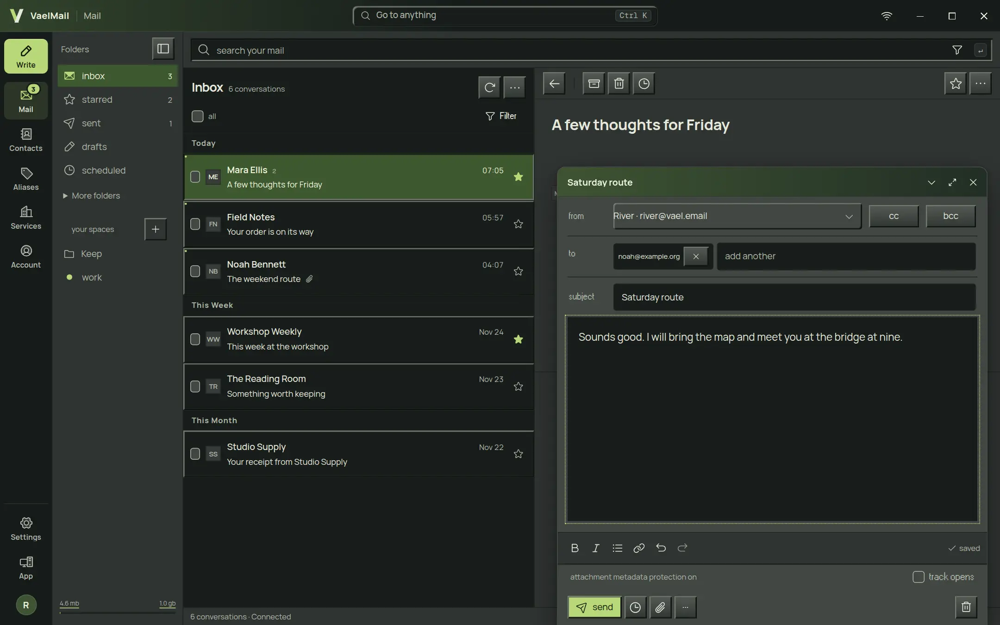<br><sub>Writing a message</sub></td>
  </tr>
  <tr>
    <td width="50%">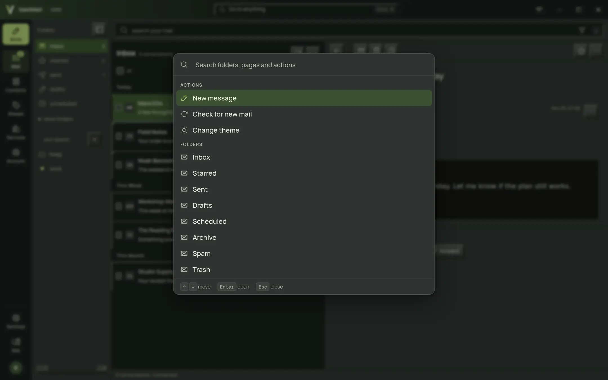<br><sub>Go to anything, <kbd>Ctrl</kbd> <kbd>K</kbd></sub></td>
    <td width="50%">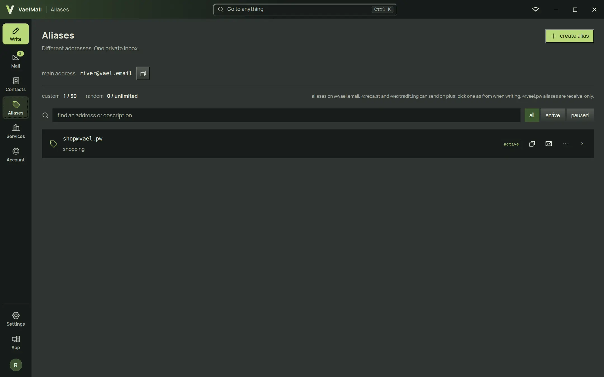<br><sub>Aliases</sub></td>
  </tr>
  <tr>
    <td width="50%">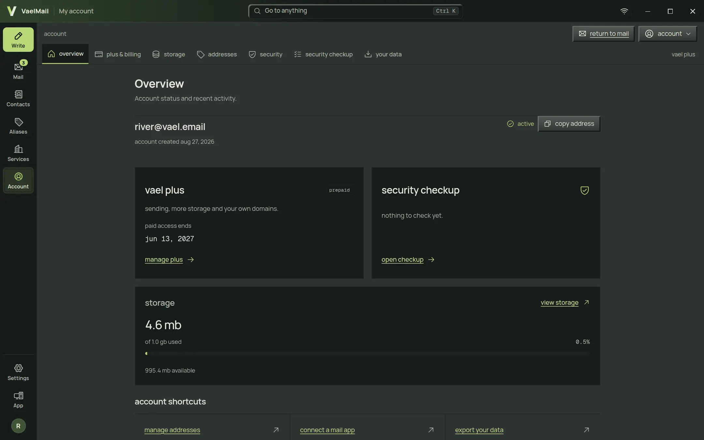<br><sub>Account</sub></td>
    <td width="50%">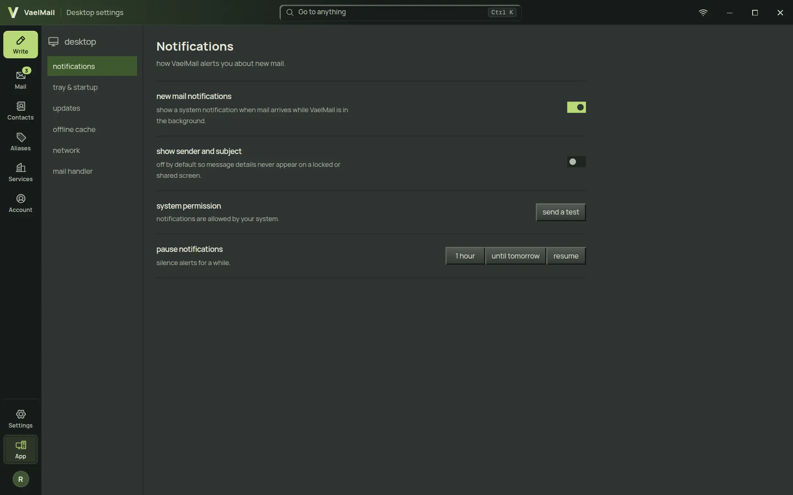<br><sub>App settings</sub></td>
  </tr>
  <tr>
    <td width="50%">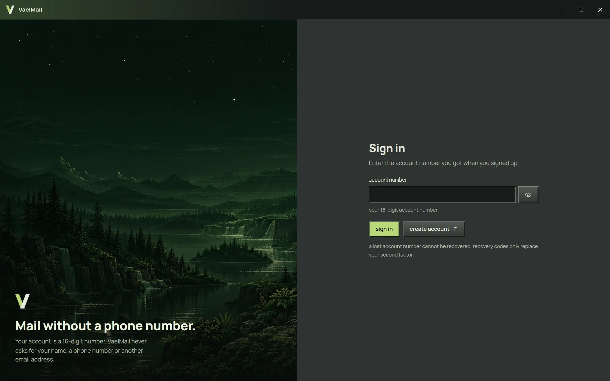<br><sub>Sign in</sub></td>
    <td width="50%">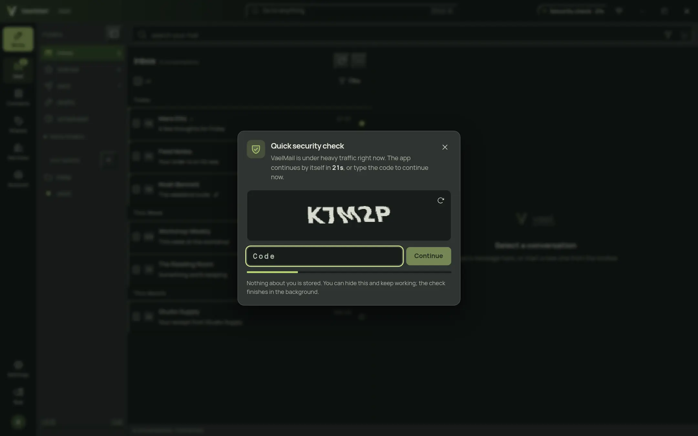<br><sub>Security check during heavy traffic</sub></td>
  </tr>
</table>

**VaelMail Setup**, the Windows installer. macOS and Linux have their own versions.

<table>
  <tr>
    <td width="33%">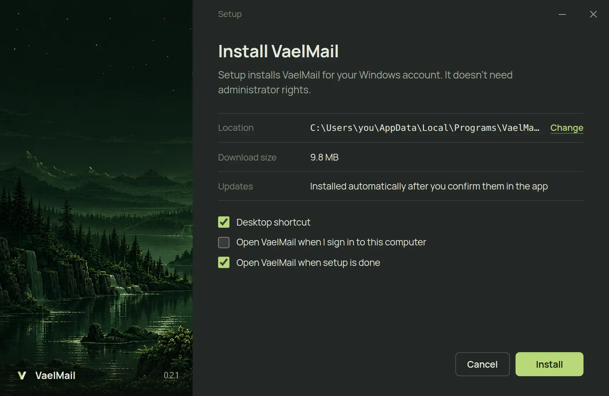</td>
    <td width="33%">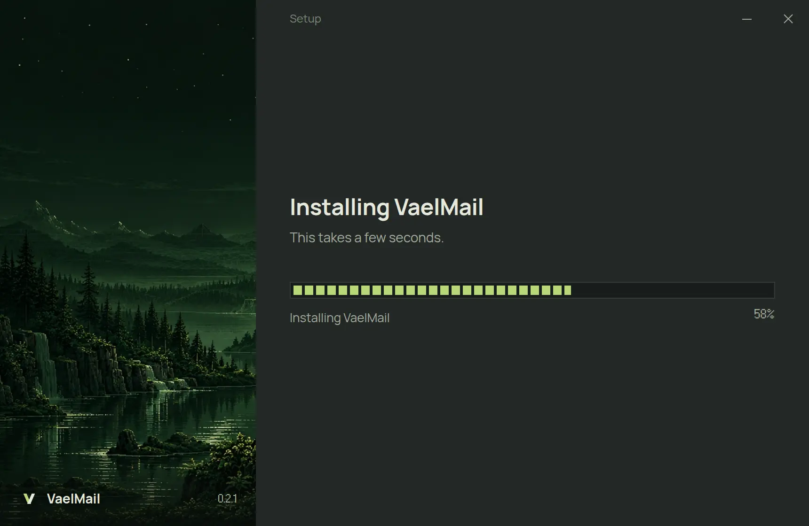</td>
    <td width="33%">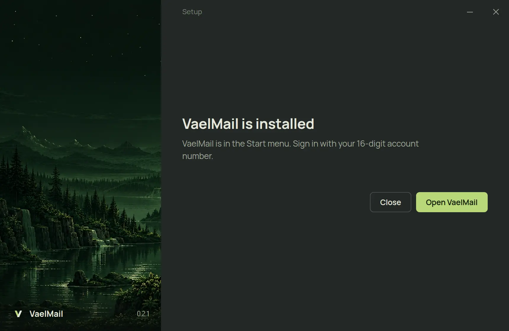</td>
  </tr>
</table>

## License

Source-available under the [PolyForm Strict License 1.0.0](LICENSE). Personal and noncommercial use is allowed. Copying, redistribution, modification and commercial use need written permission.

The Vael98 look uses [98.css](https://github.com/jdan/98.css) and [Phosphor icons](https://phosphoricons.com). Third-party licenses are in [THIRD_PARTY_NOTICES.md](THIRD_PARTY_NOTICES.md).
